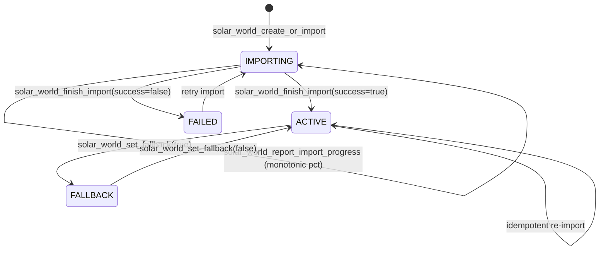
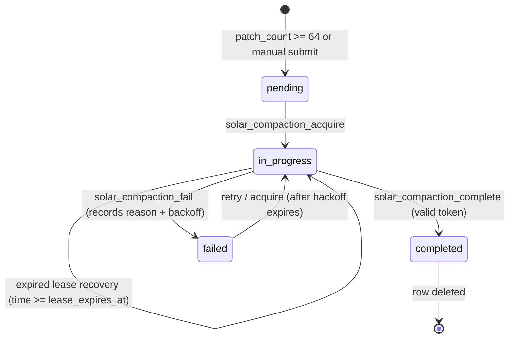

# ☀️ Solar — World Persistence & Chunk Store (Solar v1)

**Solar** is a high-performance, bounded per-chunk world persistence, delta-log replication, and streaming library designed for SpacetimeDB 2.8.2 and Minestom.

---

## 🎯 Architecture & Subsystems

Solar v1 replaces the experimental per-block prototype with a bounded, log-structured delta snapshot persistence architecture:

- **`schema/` (Rust)**: Canonical schema crate (`solar-schema`) defining the 5 core persistence tables, single-column packed `u128 chunk_key`, bounded patch batches (`MAX_EDITS_PER_PATCH = 256`), authorization hook traits, lifecycle state machines, compaction lease invariants with exponential backoff, and durable boss-bar import tracking.
- **`native/` (Rust)**: Native bridge crate (`solar-bridge`) providing:
  - Direct $O(1)$ in-memory SDK cache lookups.
  - `SolarNativeCache` with byte-accurate memory accounting, LRU eviction, and active chunk pinning.
  - $8 \times 8$ chunk tile tracking with subscriber ref-counting, duplicate suppression, and 2-chunk hysteresis margins.
  - Pure-Rust nearest-first and movement-predicted priority calculations.
  - Versioned wire envelope codec (`SOLR` magic, 48-byte header, checksum validation).
  - Pure-Rust base-plus-patch fold engine and immutable outbound frame handles (`SolarFrameHandle`).
- **`jvm/` (Java)**: Minestom loader interface (`SolarLoader`) for asynchronous chunk streaming and world lifecycle integration.

---

## 📦 Persistence Model & Tables

| Table | Primary Key | Secondary Indexes | Description |
| :--- | :--- | :--- | :--- |
| **`solar_world`** | `world_key: u64` | `world_name` (btree), `status` (btree) | World metadata, lifecycle state (`IMPORTING`/`ACTIVE`/`FAILED`/`FALLBACK`), boss-bar import progress (`total_chunks`, `completed_chunks`, `import_phase`, `failure_reason`), Harbor source revision & checksum, spawn coordinates, bounds. |
| **`solar_chunk_base`** | `chunk_key: u128` | `world_key` (btree) | Palette-compressed baseline chunk snapshot (`data: Vec<u8>`), opaque to SpacetimeDB. |
| **`solar_chunk_head`** | `chunk_key: u128` | `world_key` (btree) | Live monotonic revision tracking (`applied_revision`, `base_revision`, `patch_count`). |
| **`solar_chunk_patch`** | `id: u64` (auto_inc) | `chunk_key` (btree), `world_key` (btree) | Bounded edit batches (`edits: Vec<SolarBlockEdit>`, max 256 edits per row). |
| **`solar_compaction_request`** | `chunk_key: u128` | `world_key` (btree), `status` (btree) | Compaction lifecycle tracking (`pending`/`in_progress`/`failed`), worker lease tokens, lease expiry, retry count, and exponential backoff delay. |

---

## 🔄 Lifecycle State Machines

### 1. World Lifecycle & Import Progress

- **`IMPORTING`**: World metadata registered, baseline chunk snapshots actively streaming via `solar_chunk_base_commit`. Chunks can be streamed idempotently with resumability. Mutations (`solar_commit_edits`) fail closed.
- **`ACTIVE`**: World is live and accepting mutations, chunk reads, and compaction requests.
- **`FAILED`**: World import encountered unrecoverable errors. Read-only terminal state until re-imported.
- **`FALLBACK`**: Read-only fallback mode preserving exact Harbor source archive revision (`harbor_revision`) and checksum (`harbor_checksum`). All mutating edits are blocked.

### 2. Compaction Leasing & Backoff Recovery

- **Lease Protection**: Compaction acquisition assigns a monotonic `lease_token`, `lease_owner`, and `lease_expires_at` timestamp. Concurrent workers attempting to lease an unexpired request receive `compaction lease conflict`.
- **Fairness & Exponential Backoff**: Failing compaction increments `compaction_attempts` and sets exponential delay:
  $$\text{backoff\_micros} = \min(60\text{s}, 1\text{s} \times 2^{\min(\text{attempts}, 6)})$$
- **Safe Cutoff Rule**: When folding patches up to `compacted_up_to_revision`, the reducer prunes **only** rows where `revision <= compacted_up_to_revision`. Newer patches committed during compaction (`revision > compacted_up_to_revision`) are strictly preserved.

---

## 🧠 Native Cache, Tiles, & Codec (`solar-bridge`)

### 1. Bounded Memory Accounting & LRU Eviction
- **Byte-Accurate Footprint**: `SolarChunkFrame::approximate_byte_size()` tracks buffer capacities, patch lists, and actor strings.
- **Per-World & Global Limits**: Enforces configurable `max_world_bytes`, `max_world_frames`, `max_global_bytes`, `max_global_frames`.
- **Active Pinning**: `pin_chunk` / `unpin_chunk` refcounts pinned frames, guaranteeing active player view distances are never evicted.
- **LRU Sequence**: Automatically evicts oldest unpinned frames when limits are exceeded.

### 2. Tile Interest & Priority Calculations
- **$8 \times 8$ Chunk Tiles**: $128 \times 128$ block interest tiles $(T_X, T_Z) = (C_X \gg 3, C_Z \gg 3)$.
- **Ref-Counted Subscriptions**: `SolarTileTracker` increments/decrements subscriber counts, suppressing duplicate requests across co-located players and freeing tiles when the final subscriber departs.
- **Two-Chunk Hysteresis**: Maintains inner load envelope and outer retention boundary to eliminate churn along tile borders.
- **Priority Models**: Pure-Rust Euclidean distance and movement-predicted trajectory priority:
  $$\text{Priority} = 0.35 \times \text{CurrentDist} + 0.65 \times \text{PredictedDist}(t = 1.0\text{s})$$

### 3. Versioned Envelope Codec & Fold Engine
- **Fixed Header**: 48-byte header with magic `*b"SOLR"`, version `1`, flags, coordinates, revisions, Adler-32 checksum, and payload length.
- **Security Validation**: Rejects unsupported versions, checksum mismatches, truncated buffers, and oversized payloads ($> 4\text{MB}$).
- **Pure-Rust Fold**: Merges base palette blocks and ordered patches into an immutable packet-ready representation (`SolarFoldedChunk`).
- **Outbound Frame Ownership**: `SolarFrameHandle` provides immutable zero-copy handles with monotonic release tokens.

---

## 🔌 Lead Developer Integration Checklist

1. **Native Cache Initialization & Lifecycle**:
   - Initialize `SolarNativeCache::new(config)` on server bootstrap.
   - On world mount in Minestom: call `subscribe_world(conn, world_key)` and `cache.attach_world(world_key)`.
   - On SpacetimeDB table update for `solar_chunk_head`: invoke `cache.on_chunk_head_updated(&head)`.
   - On world unmount: call `subscription_handle.unsubscribe()` and `cache.detach_world(world_key)`.
2. **Reading Chunks**:
   - Query client SDK table caches using packed single-column key `u128 chunk_key`.
   - Call `cache.get_or_reconstruct(chunk_key, base, head, patches)` to retrieve immutable `SolarChunkFrame`.
   - For wire transport, encode via `SolarChunkEnvelope` or fold via `fold_chunk_frame`.
3. **Writing Chunks**:
   - Dispatch `solar_commit_edits(world_key, chunk_x, chunk_z, expected_revision, edits, actor, auth)`.
   - On `RevisionConflict`, re-read live head from SDK cache and retry.
