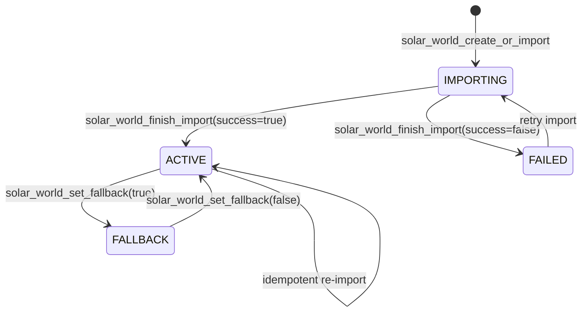
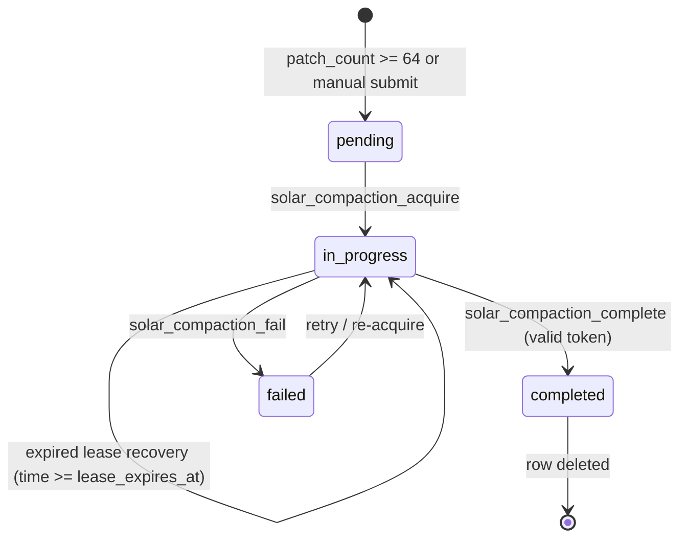

# ☀️ Solar — World Persistence & Chunk Store (Solar v1)

**Solar** is a high-performance, bounded per-chunk world persistence, delta-log replication, and streaming library designed for SpacetimeDB 2.8.2 and Minestom.

---

## 🎯 Architecture & Subsystems

Solar v1 replaces the experimental per-block prototype with a bounded, log-structured delta snapshot persistence architecture:

- **`schema/` (Rust)**: Canonical schema crate (`solar-schema`) defining the 5 core persistence tables, single-column packed `u128 chunk_key`, bounded patch batches (`MAX_EDITS_PER_PATCH = 256`), authorization hook traits, lifecycle state machines, and compaction lease invariants.
- **`native/` (Rust)**: Native bridge crate (`solar-bridge`) providing direct $O(1)$ in-memory SDK cache lookups, `SolarNativeCache` with head-revision invalidation, immutable `SolarChunkFrame` reconstruction, oneway reducer dispatch, and per-world subscriptions.
- **`jvm/` (Java)**: Minestom loader interface (`SolarLoader`) for asynchronous chunk streaming and world lifecycle integration.

---

## 📦 Persistence Model & Tables

| Table | Primary Key | Secondary Indexes | Description |
| :--- | :--- | :--- | :--- |
| **`solar_world`** | `world_key: u64` | `world_name` (btree), `status` (btree) | World metadata, lifecycle state (`IMPORTING`/`ACTIVE`/`FAILED`/`FALLBACK`), Harbor source revision & checksum, spawn coordinates, bounds. |
| **`solar_chunk_base`** | `chunk_key: u128` | `world_key` (btree) | Palette-compressed baseline chunk snapshot (`data: Vec<u8>`), opaque to SpacetimeDB. |
| **`solar_chunk_head`** | `chunk_key: u128` | `world_key` (btree) | Live monotonic revision tracking (`applied_revision`, `base_revision`, `patch_count`). |
| **`solar_chunk_patch`** | `id: u64` (auto_inc) | `chunk_key` (btree), `world_key` (btree) | Bounded edit batches (`edits: Vec<SolarBlockEdit>`, max 256 edits per row). |
| **`solar_compaction_request`** | `chunk_key: u128` | `world_key` (btree), `status` (btree) | Compaction lifecycle tracking (`pending`/`in_progress`/`failed`), worker lease tokens, lease expiry. |

---

## 🔄 Lifecycle State Machines

### 1. World Lifecycle State Machine

- **`IMPORTING`**: World metadata registered, baseline chunk snapshots actively streaming via `solar_chunk_base_commit`. Mutations (`solar_commit_edits`) fail closed.
- **`ACTIVE`**: World is live and accepting mutations, chunk reads, and compaction requests.
- **`FAILED`**: World import encountered unrecoverable errors. Read-only terminal state until re-imported.
- **`FALLBACK`**: Read-only fallback mode preserving exact Harbor source archive revision (`harbor_revision`) and checksum (`harbor_checksum`). All mutating edits are blocked.

### 2. Compaction Lease & Safe Cutoff Lifecycle

- **Lease Protection**: Compaction acquisition assigns a monotonic `lease_token`, `lease_owner`, and `lease_expires_at` timestamp. Concurrent workers attempting to lease an unexpired request receive `compaction lease conflict`.
- **Safe Cutoff Rule**: When folding patches up to `compacted_up_to_revision`, the reducer prunes **only** rows where `revision <= compacted_up_to_revision`. Newer patches committed during compaction (`revision > compacted_up_to_revision`) are strictly preserved.

---

## 🛡️ Mutation Authorization Boundary

Every mutation reducer enforces a strict 3-stage authorization pipeline before writing any data:

1. **`RegionManagerAuthorizer::authorize_edit`**: Validates region boundaries, safezones, and claim protection flags.
2. **`BlockBehaviorAuthorizer::authorize_state_change`**: Validates block placement/break legality, forbidden negative state IDs, and anti-abuse policies.
3. **`ContainerAccessAuthorizer::authorize_container_access`**: Validates chest, container, and inventory access permissions.

If any stage rejects, the transaction immediately fails closed without modifying head, base, patch, or compaction tables.

---

## ⚡ Native Subscription & Cache Lifecycle (`SolarNativeCache`)

The native bridge (`solar-bridge`) manages client memory with zero JVM object allocation:

- **Attach / Detach**: `SolarNativeCache::attach_world(world_key)` attaches a world subscription session; `detach_world(world_key)` purges all cached frames and revision maps.
- **Head Revision Invalidation**: `SolarNativeCache::on_chunk_head_updated` automatically purges cached `SolarChunkFrame` entries when `applied_revision` advances.
- **Cache Hit Path**: `SolarNativeCache::get_or_reconstruct` returns stored frames immediately when the head revision has not changed, skipping patch sorting and buffer reconstruction.

---

## 🔌 Lead Developer Integration Requirements

When wiring `solar-bridge` into the Minestom runtime:

1. **Foreign Function Interface (Panama / Native Bridge)**:
   - Call `SolarNativeCache::new()` during server initialization.
   - On world load, call `subscribe_world(conn, world_key)` and `cache.attach_world(world_key)`.
   - On table subscription updates for `solar_chunk_head`, invoke `cache.on_chunk_head_updated(&head)`.
   - On world unload, call `subscription_handle.unsubscribe()` and `cache.detach_world(world_key)`.
2. **Chunk Reading**:
   - Query SDK table caches for base, head, and patches by single-column `u128 chunk_key`.
   - Pass references to `cache.get_or_reconstruct(chunk_key, base, head, patches)`.
   - Unpack `SolarChunkFrame.base_data` using Minestom's palette decoder and apply `ordered_patches`.
3. **Chunk Writing**:
   - Dispatch `solar_commit_edits` with `(world_key, chunk_x, chunk_z, expected_revision, edits, actor, auth)`.
   - On `RevisionConflict` error, re-read live head from SDK cache and retry.

